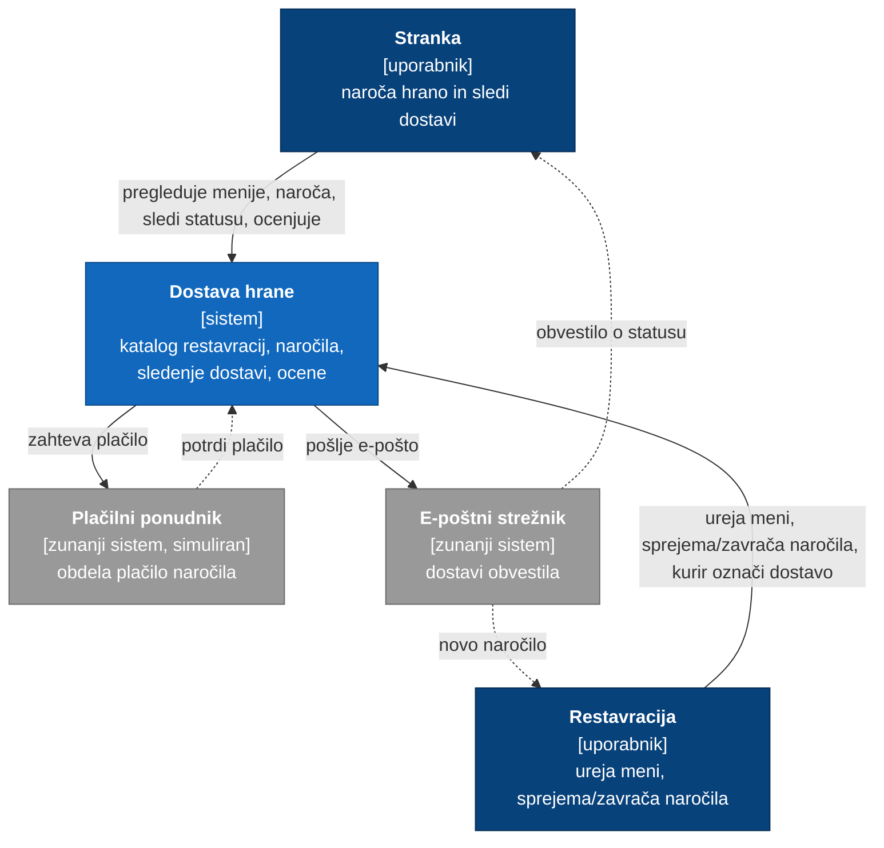

# C4 – nivo 1: kontekst sistema

Kdo uporablja sistem Dostava hrane in s katerimi zunanjimi sistemi se povezuje.

## Legenda

- **temno modro**: uporabniki sistema
- **modro**: naš sistem
- **sivo**: zunanji sistemi
- **polna črta**: sinhron klic
- **črtkana črta**: odziv ali asinhrona pot

